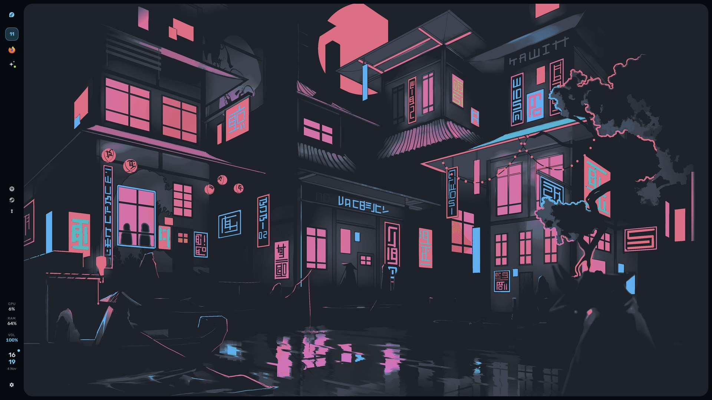
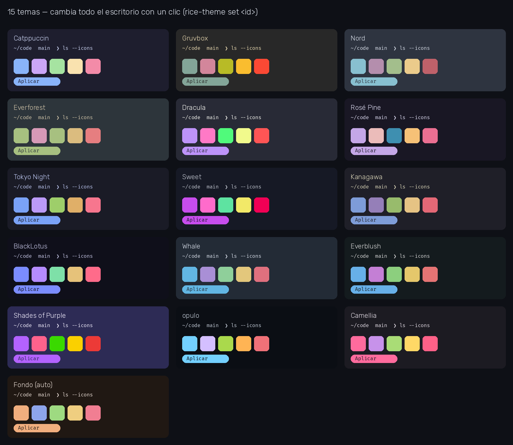
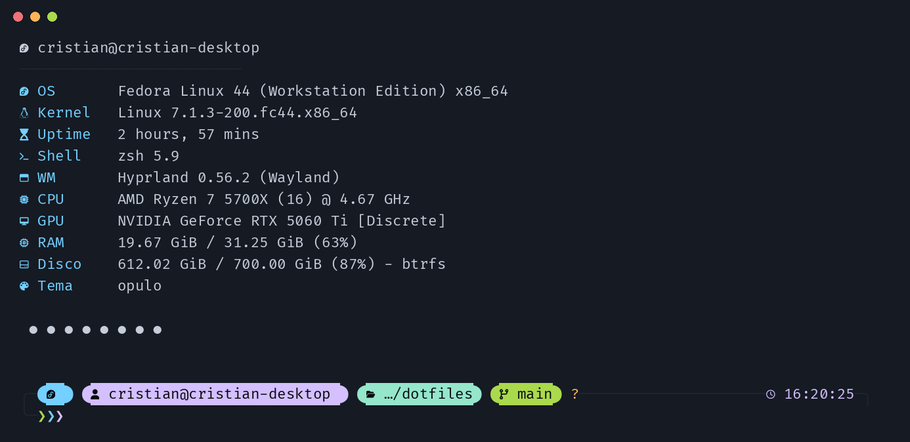

# FedoraRice

Escritorio **Fedora 44 + Hyprland 0.56 (configuración Lua) + Quickshell**, con un solo archivo de tema que lo
colorea todo: barra, paneles, terminal, prompt, bloqueo de pantalla y hasta el `fzf`.
Inspirado en [caelestia-dots/shell](https://github.com/caelestia-dots/shell) (curvas de animación y estructura de paneles).



## Qué incluye

| Pieza | Descripción |
|---|---|
| **Quickshell** (`config/quickshell/bar`) | Barra lateral, dashboard, lanzador de apps, panel de controles, notificaciones agrupadas, toasts, menú de sesión, modo juego, widgets de escritorio, ajustes y asistente con IA. |
| **Hyprland** (`config/hypr`) | `hyprland.lua` con animaciones suaves a 144 Hz (sin rebote), espacios de trabajo por grupos entre monitores, blur y sombras, y `hyprlock`. |
| **Sistema de temas** (`config/rice`) | `theme.json` + `apply.py` (`rice-theme`): **15 temas** más uno que sale del fondo de pantalla. Un comando regenera kitty, Hyprland, hyprlock, Starship, fastfetch y fzf. |
| **Terminal** (`config/kitty`, `config/zsh`, `home/zshrc`) | kitty + zsh + oh-my-zsh, prompt [Starship](https://starship.rs), bienvenida con fastfetch, fzf, zoxide, eza, bat y delta. Arranque de zsh ≈ 0,09 s. |
| **SDDM** (`sddm/`) | Tema de inicio de sesión a juego. |

## Temas



```bash
rice-theme set catppuccin     # aplica un tema a todo el escritorio (Quickshell se recarga solo)
rice-theme gtk                # sincroniza Nautilus/GTK con el tema (a propósito NO es automático)
```
También desde el panel de controles o el lanzador (“Tema: …”). Los 15 temas están en `config/rice/themes/`.

## Terminal



Bienvenida con fastfetch (≈10 ms), prompt Starship con iconos y colores del tema, `Ctrl+R` con fzf, `z proyecto`
para saltar de carpeta, `ll` con eza, `man` en color con bat y diffs de git con delta. Todo es opcional:
cada integración solo se activa si el programa está instalado (`config/zsh/qol.zsh`).

- Apagar la bienvenida: `export RICE_WELCOME=0` · volver a mostrarla: `welcome`
- Volver al prompt de oh-my-zsh: `promptomz` · al de Starship: `promptstar`

## Atajos principales

| Atajo | Acción |
|---|---|
| `Super` (solo) o `Super+D` | Dashboard |
| `Super+R` | Lanzador de apps (también comandos, temas y acciones) |
| `Super+I` | Ajustes (fondos, widgets…) |
| `Super+A` | Asistente |
| `Super+W` | Editar widgets de escritorio |
| `Super+Shift+G` | Modo juego |
| `Super+Esc` | Menú de sesión |
| `Super+L` | Bloquear |
| `Super+Q` / `Super+E` | Terminal / archivos |
| `Ctrl+Alt+←/→` | Cambiar de grupo de espacios de trabajo (en ambos monitores) |
| `Ctrl+Alt+Shift+←/→` | Mover la ventana a otro grupo |

(El resto está en `config/hypr/hyprland.lua`.)

## Instalación

Pensado para **Fedora 44 con Hyprland 0.56+** (la configuración usa la API Lua).

```bash
git clone https://github.com/CristianAlCubo/FedoraRice.git
cd FedoraRice
./install.sh --packages      # --packages instala dependencias con dnf (pide sudo); sin él, solo copia configs
```

El script **respalda** lo que sustituye en `~/.config-backup-<fecha>/`, reescribe las rutas a tu `$HOME`,
instala las fuentes (Rubik y FiraCode Nerd Font Mono) y crea el comando `rice-theme`.
**No toca tu `~/.zshrc`**: deja el del rice en `~/.zshrc.rice` para que lo compares.

Aparte, a mano:
- [oh-my-zsh](https://ohmyz.sh) y los plugins `zsh-autosuggestions` y `zsh-syntax-highlighting`.
- [Starship](https://starship.rs) (`curl -sS https://starship.rs/install.sh | sh`).
- Cursor **Bibata-Modern-Ice** e iconos **Papirus-Dark**.
- Si usas el asistente o Spotify: rellena `~/.config/nexora/env` y `~/.config/hypr/spotify-api.json`
  (se crean vacíos desde las plantillas `*.example`).
- Fondo de pantalla: no se incluye; elígelo desde Ajustes (`Super+I`).
- SDDM (opcional, requiere sudo): `sddm/install.sh`.

## Mantener el repo al día

```bash
./sync.sh     # copia tu configuración viva al repo (sin secretos ni respaldos; rutas → @HOME@)
git add -A && git commit -m "…" && git push
```
`.gitignore` y `sync.sh` excluyen claves, estado local (`wallpaper.state`, `widgets.json`), el avatar y los `*.bak*`.

## Paneles (capturas)

Para generar las capturas de dashboard, controles, lanzador y sesión: abre un workspace vacío y ejecuta
`scripts/screenshots.sh`.

## Créditos

[caelestia-dots/shell](https://github.com/caelestia-dots/shell) por la inspiración de animaciones y paneles ·
paletas de [Catppuccin](https://catppuccin.com), [Gruvbox](https://github.com/morhetz/gruvbox), [Nord](https://nordtheme.com),
[Dracula](https://draculatheme.com), [Rosé Pine](https://rosepinetheme.com), [Tokyo Night](https://github.com/folke/tokyonight.nvim)
y otras · [Starship](https://starship.rs) · [fastfetch](https://github.com/fastfetch-cli/fastfetch).

Licencia: MIT.
